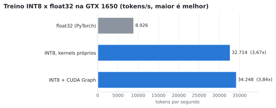
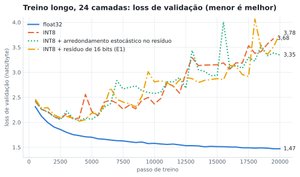
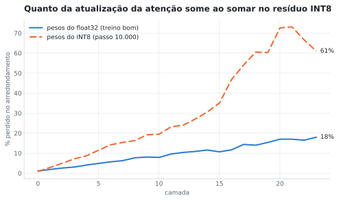
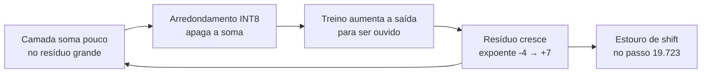
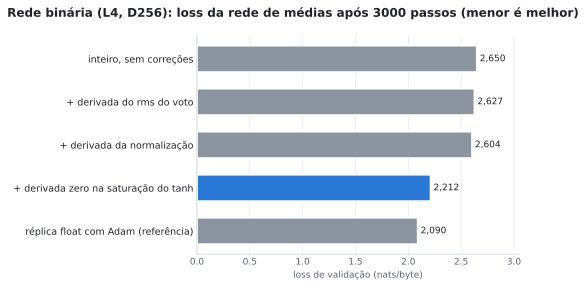
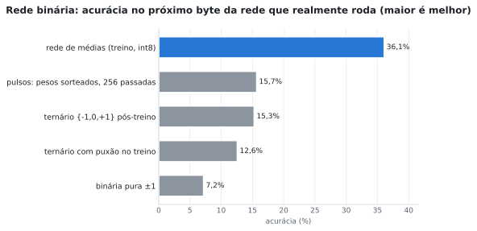
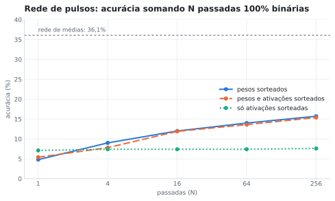
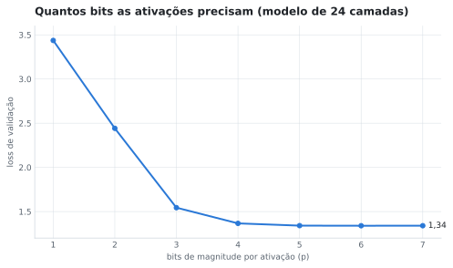

# Jataí: treinar redes neurais só com inteiros (INT8) e só com bits

-555)


Duas perguntas, testadas do zero numa GPU de consumo:

1. **INT8:** dá para *treinar* um Transformer (forward, backward e otimizador) usando **só aritmética inteira**,
   e isso é mais rápido que o float?
2. **Binário:** dá para treinar um modelo de linguagem cujos pesos e ativações finais sejam **bits**, **sem STE**
   (o atalho de gradiente usado por BitNet/XNOR-Net), nem float no método?

> [!IMPORTANT]
> **Resposta curta.** O INT8 treina **3,84x mais rápido** que o float32, com kernels que batem **bit a bit** com a
> especificação. Mas num treino longo de 24 camadas **ele para de aprender** perto do passo 3.000–4.000, e o float não.
> O binário **treina tão bem quanto o float** depois de uma correção que achamos, mas **a rede de bits que realmente
> roda perde quase tudo** (7% de acurácia contra 36%). Sem STE, não achamos um caminho. Para uso prático hoje,
> treinar em float e quantizar para Q4 depois é melhor nas duas frentes.

---

## Sumário

- [Resultados em uma tabela](#resultados-em-uma-tabela)
- [Parte 0: origem, a série "treino em inteiros puros"](#parte-0-origem-a-série-treino-em-inteiros-puros)
- [Parte 1: treino 100% INT8](#parte-1-treino-100-int8)
- [Parte 2: rede 100% binária sem STE](#parte-2-rede-100-binária-sem-ste)
- [Histórico da pesquisa: tentativas anteriores que falharam](#histórico-da-pesquisa-tentativas-anteriores-que-falharam)
- [Quanto trabalho dá para cortar sem gastar memória](#quanto-trabalho-dá-para-cortar-sem-gastar-memória)
- [Vale a pena? Comparação com o caminho tradicional](#vale-a-pena-comparação-com-o-caminho-tradicional)
- [Lições](#lições)
- [Hardware usado](#hardware-usado)
- [Estrutura do repositório](#estrutura-do-repositório)
- [Reprodução](#reprodução)
- [Licença e como citar](#licença-e-como-citar)

---

## Resultados em uma tabela

| | O que deu certo ✅ | O que deu errado ❌ | Por quê |
|---|---|---|---|
| **INT8** | Treino 3,84x mais rápido que o float32; kernels exatos bit a bit; diagnóstico que localiza qualquer erro no kernel e na posição | Modelo de 24 camadas para de aprender no passo ~3.000 (melhor validação 2,03; o float chega a 1,47 no passo 20.000) | O fluxo residual cresce sem parar e a soma em INT8 apaga até 67% do que as camadas de cima escrevem; o crescimento em si ficou sem explicação |
| **Binário** | O treino inteiro alcançou o float: loss 2,21 contra 2,09 (antes: 2,65) | A rede de bits que roda fica em 7% de acurácia (rede de médias: 36%); pulsos e ternário chegam só a 13–16% | O treino otimiza a rede de *médias*; nenhuma conversão para bits depois sobrevive num modelo de 2,8 M pesos |

---

## Parte 0: origem, a série "treino em inteiros puros"

Experimentos curtos que vieram antes da biblioteca INT8 e decidiram o formato dela. Cada um tem README, código e
resultados próprios em [`origem_int8/`](origem_int8/).

| experimento | pergunta | resultado principal |
|---|---|---|
| [1. indução INT8](origem_int8/experimento_int8_inducao/) | um Transformer 100% inteiro **aprende**? (tarefa de indução, acaso 6,25%) | ✅ o esquema novo (B, B_det, B_calc) chega a **100%**, igual à referência float. ❌ o método anterior (A) fica no acaso (5,6–6,3%): os pesos colam em ±127. Ressalva: 1 semente, CPU, modelo minúsculo (D = 32) |
| [3. análise passo a passo](origem_int8/experimento_analise_int8/) | onde o valor passa de 8 bits e quanto a direção do gradiente desvia (12 camadas) | cosseno do gradiente inteiro contra o float64 de **0,993–0,9995**; ReLU² e ALiBi são as escolhas mais fiéis |
| [4. expoente por bloco de 32](origem_int8/experimento_bloco32/) | um expoente por bloco reduz o desvio? | desvio após 12 camadas de **9,4%** (bloco) contra 21,5% (expoente por tensor); BF16: 1,5%; 0 saturações em 7 milhões de valores |
| [6. kernel GEMM INT8](origem_int8/kernel_int8_b32/) | o formato multiplica matrizes mais rápido que o FP32 nesta GPU? | ✅ **2,3–2,8x** o FP32 equivalente e **1,8–3,9x** o cuBLAS FP32; pico medido do `dp4a`: 10,06 TOPS. ❌ GEMM só com bits: 8,6–12x mais lento |
| [apoio: gargalo da VRAM](origem_int8/experimento_gargalo_vram/) | quanto custa gravar na memória a cada etapa? | etapas separadas são **7,5x** mais lentas que fundidas; banda real 121 de 192 GB/s, o que motivou fundir operações nos kernels |

Os experimentos 1, 3 e 4 medem só fidelidade numérica ou tarefas pequenas, com pesos aleatórios ou um modelo
minúsculo. A prova de aprendizado em escala é a Parte 1. O experimento 5 (protótipo inteiro em PyTorch) está em
`treino_int8_gpu/`.

---

## Parte 1: treino 100% INT8

Cada tensor é guardado como **mantissa INT8 + expoente inteiro por bloco**. Todo o treino (atenção, RMSNorm,
ReLU², softmax, entropia cruzada, momento) roda em kernels CUDA próprios (`jatai_cuda.cu`, ~1000 linhas), com uma
especificação em inteiros de 64 bits que serve de gabarito.

### ✅ Velocidade e exatidão

<picture>
  <source media="(prefers-color-scheme: dark)" srcset="figuras/int8_velocidade_escuro.svg">
  
</picture>

| Modelo de 12 camadas, lote de 2048 tokens | tokens/s | vs float32 |
|---|---|---|
| float32 (PyTorch) | 8.926 | 1,00x |
| INT8, kernels próprios | 32.714 | 3,67x |
| INT8 + CUDA Graph | **34.248** | **3,84x** |

- **Exatidão:** 53 de 53 casos de teste e 1044 de 1044 operações de dois passos completos batem bit a bit com a
  especificação. O treino de 600 passos dá as mesmas losses, até a 5ª casa decimal, em cinco versões da
  biblioteca.
- **Memória:** com lote de 4096 tokens, o float32 não cabe nos 4 GB; o INT8 cabe.
- **Do protótipo à biblioteca:** de ~170 tokens/s (PyTorch com inteiros) para ~34.000 (~200x).

### ❌ O treino longo não se sustenta

Modelo de 24 camadas (31,6 M parâmetros), corpus inteiro (99 MB), mesmos pesos iniciais e mesmos lotes nos dois
modos:

<picture>
  <source media="(prefers-color-scheme: dark)" srcset="figuras/int8_treino_longo_escuro.svg">
  
</picture>

| passo | float32 | INT8 | INT8 + arredondamento estocástico no resíduo |
|---|---|---|---|
| 2.500 | 1,856 | **2,068** (melhor) | 2,053 (melhor: 2,033 no passo 4.000) |
| 10.000 | 1,580 | 2,367 | 2,578 |
| 19.500 | 1,471 | 3,678 (estourou no 19.723) | 3,388 |

### 🔎 Por quê: o resíduo "engole" as camadas de cima

O resíduo é guardado com 7 bits de mantissa. Se o que uma camada soma for menor que meio degrau dessa mantissa,
o arredondamento leva a soma para zero. Medimos quanto da saída da atenção se perde em cada camada, com os pesos de
cada modo:

<picture>
  <source media="(prefers-color-scheme: dark)" srcset="figuras/int8_absorcao_escuro.svg">
  
</picture>



- O expoente do resíduo subiu de −4 para +7 (2¹¹ = 2048x). A ReLU² da camada 0 morreu: os zeros foram de 57% para 94%.
- **Correção testada:** arredondamento estocástico na soma residual (`jt_res_estocastico`). A atualização pequena
  passa a sobreviver na média. Isso **evitou o estouro**, mas **não a degradação**. A absorção agrava o problema, mas
  não o causa: o que faz o resíduo crescer ficou em aberto.

---

## Parte 2: rede 100% binária sem STE

A arquitetura é própria, sem atenção: soma temporal com decaimento, "voto" residual e saída `sinal(popcount)`.
O treino é um **observador**: cada peso é um contador int8 θ, e o treino propaga a *média* de cada bit
(`tanh` do campo médio). A rede final usa `sinal(θ)`. Não há STE e não há float no método.

### ✅ O treino inteiro alcançou o float

Uma réplica em float da mesma arquitetura, comparada etapa por etapa com a versão inteira (`comparar_camadas.py`),
achou três erros na derivada. O decisivo é o **tanh inteiro saturado**:

- O tanh inteiro vira 127 já a partir de ~2,8.
- Ali a derivada inteira fica num piso de 1,6%, quando a verdadeira é quase 0.
- Esse gradiente falso empurrava os pesos até ±127, saturava o voto e transformava o gradiente em ruído: o cosseno
  com o gradiente exato caía para **0,006** no último bloco.

<picture>
  <source media="(prefers-color-scheme: dark)" srcset="figuras/bit_treino_escuro.svg">
  
</picture>

| correção | o que corrige | loss (3000 passos) |
|---|---|---|
| nenhuma | — | 2,650 |
| derivada do rms do voto (`JB_VRMS`) | o kernel tratava o rms como constante (custava 0,27 na réplica) | 2,627 |
| derivada da normalização (`JB_PROJ`) | idem nas camadas escondidas | 2,604 |
| **derivada zero na saturação (`JB_SAT`)** | o piso falso do tanh inteiro | **2,212** |
| *réplica float com Adam* | *referência* | *2,090* |

### ❌ Mas a rede de bits que roda perde quase tudo

<picture>
  <source media="(prefers-color-scheme: dark)" srcset="figuras/bit_lacuna_escuro.svg">
  
</picture>

Tentamos três formas de guardar a nuance perdida:

| ideia | como | resultado |
|---|---|---|
| **grupos de bits** (k bits por peso) | cada peso vira um número de 2–4 bits, lido de k planos de bits | 2 bits recuperam quase tudo, mas aí já não é binário (é int2) |
| **pulsos** (nuance no tempo) | cada passada é 100% binária, com bits sorteados pela média; somam-se N passadas | 15,7% com 256 passadas: melhora devagar demais |
| **ternário {−1, 0, +1}** | peso indeciso vira 0, como "sem pulso" | 15,3% depois do treino; puxar para ternário durante o treino deu 12,6% |

<picture>
  <source media="(prefers-color-scheme: dark)" srcset="figuras/bit_pulsos_escuro.svg">
  
</picture>

### 🔎 Por quê

- **A nuance está nos pesos.** O contador médio fica em |θ| ≈ 34 de 127: a maioria dos pesos é "indecisa", com
  ~63% de chance de ser +1. Congelar isso em ±1 apaga a informação. Sortear só as ativações não muda nada.
- **O treino nunca enxerga a rede que vai rodar.** Ele otimiza a rede de médias, e a de bits é obtida depois.
  Como as não-linearidades se encadeiam, a média da rede sorteada não é a rede de médias.
- O caminho conhecido para isso é o **STE**: o forward passa pela rede quantizada de verdade. O projeto o exclui
  por princípio, e mesmo com STE, o BitNet só alcança o float em modelos de centenas de milhões de pesos.

---

## Histórico da pesquisa: tentativas anteriores que falharam

Antes das Partes 0 a 2, o projeto testou outras arquiteturas. As que têm medição estão abaixo, com o motivo da
falha. O código delas não está neste repositório: estes resultados ficam como registro e como lição.

| tentativa | ideia | o que aconteceu (medido) | por quê |
|---|---|---|---|
| **Kronecker em GF(2)** | pesos como produto de Kronecker sobre bits, resolvidos por álgebra (Gauss-Jordan em GF(2)) | no exemplo sintético de 1 amostra: **0 de 512 bits errados**. Em texto real (14.000 passos): **acerto 0,00%, loss 10,92**, o mesmo que chutar ao acaso entre ~55 mil tokens | resolver um sistema exato decora um exemplo; não generaliza. Em GF(2), camadas lineares se compõem numa só, e a paridade é a função mais "áspera" possível |
| **APB-1650, por mutação** (v8–v14) | virar bits ao acaso e manter os melhores mutantes (evolução, annealing) | distância de Hamming de **255–256 de 512**, exatamente o acaso, com 97% das mutações aceitas | busca às cegas não escala num espaço de 2^196.608 combinações; escolher o melhor de 31 mutantes no mesmo lote seleciona ruído |
| **APB-1650, Hebbiano / Willshaw** (v27–v42) | memória associativa de uma passada (`OR` acumulativo), MoE em bits | "tempestade de uns": com contexto por `OR`, a densidade foi de 1,9% para 31% e o Hamming de ~125 para **1992 de 2048** (a rede liga todos os bits); a inferência gerava texto sem sentido | `OR` só acumula, nunca desliga: a matriz satura. Atenção precisa de pesos graduados |
| **Média de dimensões** (Qwen3.5-0.8B) | reduzir as cabeças de 256 para 4–64 dimensões por média ou PCA, sem retreinar | perplexidade de 13,96 para **16,8–39,9** (1,2x a 2,9x pior), e o modelo encolhe só **4,4–5,8%** | as cabeças são uma fração pequena dos pesos; e média/PCA sem retreino destrói o que elas aprenderam |
| **Método inteiro em faixa fixa ±20** | inteiros pequenos com tabelas (LUT), sem escala | não aprende: **5,6–7,7%** de acerto na indução (acaso 6,25%) | `−1 >> k = −1`: o arredondamento puxa sempre para o mesmo lado e prende 97,7% dos pesos em +127. Corrigido na Parte 0 (arredondamento simétrico) |

**Lições levadas adiante:** sinal de gradiente em vez de busca às cegas; somas inteiras graduadas em vez de `OR`;
avaliar com entropia cruzada e com referência (float, n-grama, acaso), nunca só com Hamming ou com acerto nos
próprios dados de treino; arredondamento simétrico.

*Outras ideias exploradas no projeto (ressonância por hash, DNA/CRISPR em 2 bits, redes Kronecker em INT32,
ARMB, BIRA e cerca de 20 arquiteturas de teste) ficaram como especificação ou protótipo sem comparação com uma
referência, e por isso não entram aqui como resultado.*

---

## Quanto trabalho dá para cortar sem gastar memória

Medido no modelo de 24 camadas, sem kernel novo (`medir_tempo.py`):

| ideia | resultado | vale? |
|---|---|---|
| **pular zeros** da entrada de `Wd` (67% são zero depois da ReLU²) | **−27%** do trabalho das multiplicações, resultado exato | ✅ sim |
| calcular só o que mudou entre tokens (delta) | só 1–2% das ativações se repetem | ❌ não |
| parar cedo por confiança | −9% sem perder acurácia; −15% com loss +0,09 | ⚠️ pouco (o modelo não foi treinado para isso) |
| ativações com menos bits | 5 bits bastam (loss 1,341 contra 1,340); 4 bits: 1,366 | ⚠️ só ajuda com hardware de 4 bits |

<picture>
  <source media="(prefers-color-scheme: dark)" srcset="figuras/int8_bits_ativacao_escuro.svg">
  
</picture>

---

## Vale a pena? Comparação com o caminho tradicional

| | Tradicional (float/bf16 + Q4 pós-treino) | Jataí INT8 | Jataí binário |
|---|---|---|---|
| Qualidade | ≈ float | ❌ para de aprender no treino longo | ❌ 7–16% contra 36% |
| Memória na inferência | ~4,5 bits/peso | 8 bits/peso | 1–2 bits (se funcionasse) |
| Velocidade de treino | referência | ✅ 3,84x numa GPU sem tensor cores | — |
| Maturidade | pronto | pesquisa | pesquisa |

> [!NOTE]
> A única vantagem real é **treinar barato numa GPU sem tensor cores**. Numa GPU moderna com bf16 em tensor
> cores, essa vantagem provavelmente desaparece; os nossos kernels usam `dp4a`, não tensor cores. Por isso as duas
> frentes foram **encerradas como produto** e ficam documentadas como pesquisa.

---

## Lições

1. **Compare etapa por etapa com uma réplica exata.** Semanas de hipóteses foram resolvidas numa tarde quando
   medimos o cosseno de cada gradiente contra a derivada exata. O erro estava num único lugar: o piso do tanh.
2. **Aproximações inteiras de funções que saturam precisam de derivada zero na saturação.** Senão o gradiente
   falso cria um ciclo que se realimenta.
3. **Somar em baixa precisão num acumulador que cresce apaga as contribuições pequenas.** Vale para o resíduo de
   qualquer rede quantizada.
4. **Quantizar depois não substitui treinar a rede que vai rodar.** Em modelos pequenos, cada peso pesa demais.
5. **Defina um critério de corte antes de cada teste.** Foi o que encerrou o projeto no momento certo.

---

## Hardware usado

Toda a pesquisa rodou num PC de consumo antigo, de propósito: a pergunta era o que dá para fazer **sem** hardware
de IA.

| componente | especificação |
|---|---|
| **GPU** | NVIDIA GeForce **GTX 1650**, arquitetura Turing (TU117), **4 GB**, 896 núcleos CUDA, **sem tensor cores**, 75 W |
| instruções usadas | `dp4a` (produto INT8 de 4 elementos), `popc`/XOR para os planos de bits; compilado para `sm_75` |
| barramento | PCIe 2.0 x16 (limite da placa-mãe) |
| **CPU** | Intel Core **i5-2500** (Sandy Bridge, 2011), 4 núcleos / 4 threads, 3,3–3,7 GHz, 6 MB de L3 |
| placa-mãe | Intel B75 |
| RAM | 16 GB |
| armazenamento | SSD SATA de 256 GB (sistema) + HD de 1 TB |
| sistema | Ubuntu 24.04.5 LTS, kernel Linux 7.0 |
| software | driver NVIDIA 580.178.04, CUDA 12.0 (`nvcc` 12.0.140), Python 3.12.3, PyTorch 2.6.0+cu124, matplotlib 3.11 (figuras) |
| execução | todos os treinos e medidas com `taskset -c 0-1 nice -n 19` (2 núcleos de CPU, prioridade baixa) |

Medidas de velocidade feitas em A/B alternado (mesma máquina, mesma carga), sempre contra o PyTorch float32 na
mesma GPU. Nesta GPU o fp16 é 2–5x **mais lento** que o fp32, por isso a referência é o fp32.

---

## Estrutura do repositório

```
├── README.md                 este resumo
├── LICENSE                   MIT (código)
├── LICENSE-DOCS.md           CC BY 4.0 (textos, figuras, resultados)
├── CITATION.cff              como citar
├── gerar_graficos.py         gera figuras/ a partir dos logs
├── figuras/                  gráficos em versão clara e escura (SVG)
├── origem_int8/              série "treino em inteiros puros" (experimentos 1, 3, 4, 6 e VRAM)
├── jatai_cuda/               treino 100% INT8
│   ├── jatai_cuda.cu         biblioteca CUDA (todos os kernels do treino)
│   ├── ops.py, modelo.py     chamadas aos kernels e o Transformer INT8
│   ├── registro.py           sistema de logs que localiza erros numéricos
│   ├── treino_cuda.py        treino curto e medida de velocidade A/B
│   ├── noite.py, noite.sh    treino longo (24 camadas) INT8 x float32
│   ├── teste_ops.py          testes bit a bit contra a especificação
│   ├── diag_residuo.py       diagnóstico da absorção no resíduo
│   ├── medir_tempo.py        quanto trabalho dá para cortar
│   ├── RELATORIO_TECNICO.md  relatório completo
│   └── logs/                 resultados usados nas figuras
├── jatai_bit/                rede 100% binária
│   ├── libbit.cu             kernels: GEMM de bits/planos, normalizações, voto, derivadas
│   ├── fase1c_kernel.py      especificação int64 e chamadas aos kernels
│   ├── modelo_bit.py         modelo de linguagem binário, treino e conferência
│   ├── comparar_camadas.py   inteiro x réplica float, etapa por etapa
│   ├── diag_float_modelo.py  réplica float e a "escada" de diagnóstico
│   ├── pulsos.py, ternario.py, treino_ternario.py, precisao_bits.py
│   ├── PLANO.md              diário completo da pesquisa
│   └── logs/
└── treino_int8_gpu/          dados (leitura e lotes) e referência float/INT8 em PyTorch
```

---

## Reprodução

**Dados:** os scripts leem `Portuguese.jsonl` e `English.jsonl` (uma linha JSON por texto, campo `"text"`) da pasta
`dados/` na raiz do repositório, ou da pasta indicada em `JATAI_DADOS`. Uma linha em cada 20 vai para a validação.

<details>
<summary><b>Comandos</b></summary>

```bash
# biblioteca INT8
cd jatai_cuda && nvcc -O3 -arch=sm_75 -shared -Xcompiler -fPIC jatai_cuda.cu -o libjatai.so
python treino_cuda.py velocidade 8                       # velocidade A/B contra o float32
python noite.py int8 24 2048 8 20000 500                 # treino longo (JATAI_RES_EST=1: resíduo estocástico)
python diag_residuo.py logs/noite_int8_pesos.pt          # absorção no resíduo
python medir_tempo.py                                    # delta, bits por ativação, parar cedo

# rede binária
cd jatai_bit && nvcc -O3 -arch=sm_75 -shared -Xcompiler -fPIC libbit.cu -o libbit.so
python modelo_bit.py conferir                            # kernels x especificação int64, bit a bit
JB_VRMS=1 JB_PROJ=1 JB_SAT=3584 python modelo_bit.py treinar 3000 4 256 1024 8 6 1
JB_VRMS=1 JB_PROJ=1 python comparar_camadas.py 0,1000    # inteiro x réplica float, etapa por etapa
python pulsos.py 3000                                    # rede de pulsos
python ternario.py logs/pulsos_modelo_3000.pt            # ternário pós-treino

# figuras deste README
cd publicacao && python3 gerar_graficos.py
```
</details>

<details>
<summary><b>Documentação completa</b></summary>

- [`jatai_cuda/RELATORIO_TECNICO.md`](jatai_cuda/RELATORIO_TECNICO.md): o relatório do INT8, com o formato, os
  kernels, as provas dos limites de bits, os resultados negativos e o treino longo (seção 7.7).
- [`jatai_bit/PLANO.md`](jatai_bit/PLANO.md): o diário da rede binária, das fases 0 a 22, com todos os
  experimentos (as seções 22.5 a 22.9 cobrem os resultados deste resumo).
- Logs brutos: `jatai_cuda/logs/` e `jatai_bit/logs/`.
</details>

---

## Licença e como citar

- **Código** (kernels e scripts): [MIT](LICENSE). Uso livre, inclusive comercial, mantendo o aviso de copyright
  com o nome do autor.
- **Textos, figuras e resultados:** [CC BY 4.0](LICENSE-DOCS.md). Uso livre **com crédito ao autor**.
- Ao usar todo ou parte desta pesquisa ou das ideias, cite:

> Cadmiel L. P. de Almeida. *Jataí: treino de redes neurais só com inteiros (INT8) e só com bits, numa GPU sem tensor
> cores.* 2026. https://github.com/kdilim/jatai

O botão **"Cite this repository"** do GitHub gera essa citação a partir de [`CITATION.cff`](CITATION.cff).
