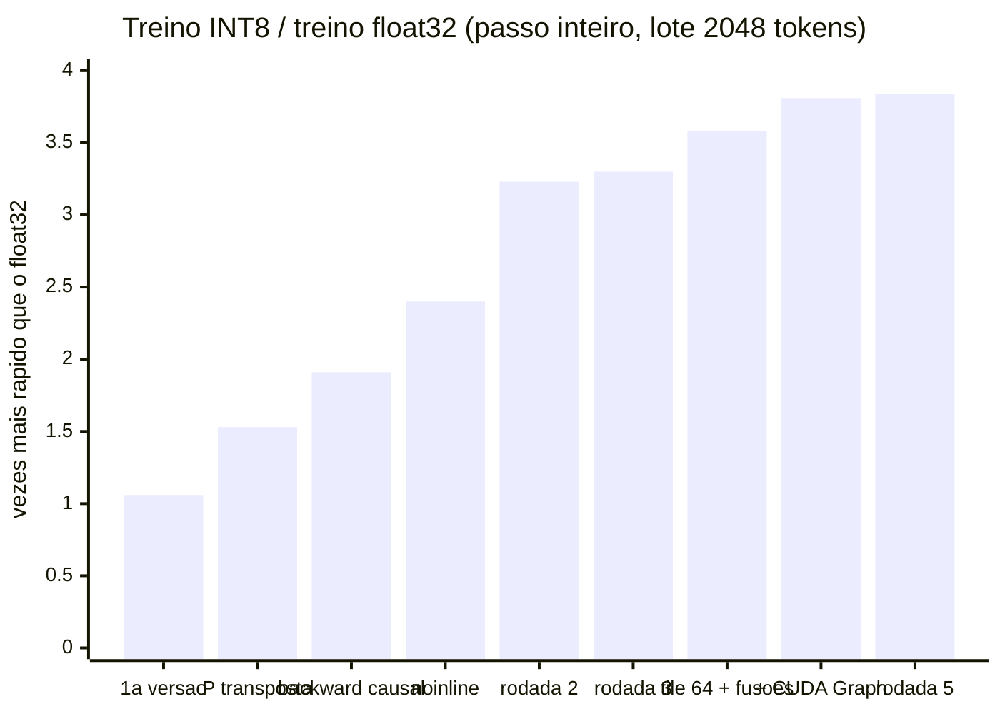

# Treino de Transformer 100% inteiro em INT8 numa GPU sem tensor cores

**Relatório técnico do projeto Jataí — série "treino em inteiros puros" (experimentos 1 a 7)**
Versão de 2026-11-03. Código, logs e resultados: este repositório.

---

## Resumo

Investigamos se um Transformer pode ser **treinado** (forward, backward e atualização dos pesos) usando só
aritmética inteira, com todo tensor guardado como mantissa INT8 mais um expoente inteiro por bloco de 128
valores, e se isso é **mais rápido** que o treino tradicional em ponto flutuante numa GPU de consumo sem tensor
cores (GTX 1650, Turing TU117). Escrevemos do zero uma biblioteca CUDA (`jatai_cuda.cu`, ~1000 linhas) com
todos os kernels do treino, uma referência em Python com inteiros de 64 bits que serve de especificação, e um
sistema de logs que localiza qualquer anomalia numérica no kernel, no trecho do modelo e na posição exata.

Resultados principais, num Transformer de 12 camadas (D = 256, 64 cabeças de dimensão 4, FF = 1024, contexto
128, vocabulário de bytes), mesmos pesos iniciais, dados e otimizador que a referência em float32 do PyTorch:

- **Velocidade:** 3,67x o float32 com lote de 2048 tokens (32.714 contra 8.926 tokens/s) e **3,84x** com o
  passo gravado num CUDA Graph (34.248 tokens/s). Com lote de 1024: 3,35x e 3,73x.
- **Correção:** os kernels batem **bit a bit** com a especificação em 53 casos de teste e em 1044 de 1044
  operações de dois passos completos de treino; o treino de 600 passos reproduz as mesmas losses até a 5ª casa
  decimal em cinco versões diferentes da biblioteca (com e sem CUDA Graph).
- **Qualidade:** loss de validação 2,280 no passo 600, contra 2,123 do float32 (treino: 2,229 contra 2,124).
  A diferença é maior do que a simulação do formato previa (2,169) e é o principal problema em aberto.
- **Resultados negativos documentados:** multiplicação de matriz só com operações de bit (8,6–12x mais lenta que
  o dp4a), guardar intermediários da atenção para economizar passadas (0,38–0,56x), fusões na saída da GEMM
  com baixa ocupação (0,82–0,92x), entre outros, cada um com a causa medida.

---

## Sumário

1. [Pergunta e critérios](#1-pergunta-e-critérios)
2. [Ambiente e metodologia de medição](#2-ambiente-e-metodologia-de-medição)
3. [O formato numérico](#3-o-formato-numérico)
4. [O modelo e cada operação inteira](#4-o-modelo-e-cada-operação-inteira)
5. [Verificação: especificação executável, testes e sistema de logs](#5-verificação)
6. [Histórico experimental (experimentos 1 a 6)](#6-histórico-experimental-experimentos-1-a-6)
7. [Engenharia de desempenho da biblioteca CUDA (experimento 7)](#7-engenharia-de-desempenho-da-biblioteca-cuda-experimento-7)
8. [Resultados finais](#8-resultados-finais)
9. [Discussão](#9-discussão)
10. [Limitações e ameaças à validade](#10-limitações-e-ameaças-à-validade)
11. [Trabalho futuro](#11-trabalho-futuro)
12. [Reprodução](#12-reprodução)
- [Apêndice A — Provas dos limites de bits](#apêndice-a--provas-dos-limites-de-bits)
- [Apêndice B — Mapa de arquivos e logs](#apêndice-b--mapa-de-arquivos-e-logs)

---

## 1. Pergunta e critérios

**Pergunta.** É possível treinar um Transformer com aritmética 100% inteira, guardando tudo em INT8, e isso é
mais rápido que o treino tradicional em float?

**Critérios definidos pelo autor do projeto antes dos experimentos:**

1. *Só inteiros no método.* Nenhuma conta de ponto flutuante no forward, no backward ou no otimizador. Float
   aparece apenas (a) na referência de comparação, (b) em ablações de diagnóstico, que nunca entram no método, e
   (c) no relatório da loss, que converte para `double` só para imprimir.
2. *Tudo que é guardado é INT8.* Valores maiores existem só em registrador, dentro de um kernel. O expoente por
   bloco é metadado de 1 byte a cada 128 valores (0,8%).
3. *Velocidade:* o trabalho só se justifica se o treino for **mais de 2x mais rápido** que o treino em
   FP16/FP32. O alvo é o pico do `__dp4a` (produto escalar de 4 pares INT8 com acumulação int32).
4. *Do zero:* os kernels do método são escritos neste projeto. Bibliotecas de terceiros (cuBLAS, kernels do
   PyTorch) aparecem só como régua. O PyTorch é usado para alocar memória, carregar dados, servir de referência
   em float e executar a especificação de referência.

Uma dúvida levantada durante o trabalho foi se o método seria uma forma de *quantization-aware training*
(QAT). Não é: no QAT o modelo treina em float e simula o arredondamento; aqui não existe cópia em float dos
pesos nem das ativações. As simulações em float com arredondamento (`floatq`, seção 6.5) foram usadas só como
**ferramenta de diagnóstico**, para separar o custo do formato do custo da implementação.

---

## 2. Ambiente e metodologia de medição

### 2.1 Hardware e software

| item | valor |
|---|---|
| GPU | NVIDIA GeForce GTX 1650 (notebook), Turing TU117, 14 SMs, 4 GB, sem tensor cores |
| clocks máximos | SM 2130 MHz, memória 6001 MHz; L2 de 1 MB; barramento de 128 bits |
| tetos medidos | `__dp4a` 10,06 TOPS; FMA FP32 2,52 TFLOPS; HFMA2 FP16 5,04 TFLOPS (`kernel_int8_b32/pico.cu`); VRAM 121 GB/s lendo e gravando (`experimento_gargalo_vram`) |
| CPU | Intel Core i5-2500 @ 3,30 GHz, 4 núcleos, 1 thread por núcleo; 15 GB de RAM |
| software | Linux 7.0, driver 580.178.04, CUDA 12.0 (`nvcc` V12.0.140), Python 3.12.3, PyTorch 2.6.0+cu124 |
| compilação | `nvcc -O3 -arch=sm_75 -shared -Xcompiler -fPIC jatai_cuda.cu -o libjatai.so` |

Contagem de operações: 1 multiplicação + 1 soma = 2 operações; um `dp4a` = 8 operações. "TOPS" = 2·M·N·K / tempo.

### 2.2 Variação de clock e o protocolo A/B alternado

O clock do SM desta GPU de notebook variou entre ~1410 MHz (sob carga contínua) e 2130 MHz conforme a
temperatura e a carga recente (medido com `nvidia-smi` durante os testes). Por isso o mesmo kernel deu números
diferentes em execuções diferentes: por exemplo, a atenção backward mediu 1,33 ms numa execução e 1,68 ms na
seguinte, sem mudança de código.

**Correção posterior (2026-11-03, projeto Jataí-bit):** o teto do dp4a também escala com o clock. Medido em
sequência na mesma sessão: 9,99 TOPS com o SM a 1410 MHz e 13,50 TOPS a 1875 MHz. O teto de 10,06 TOPS usado neste
relatório (seção 2.1) foi medido com o clock baixo; como as GEMMs costumam rodar com a GPU aquecida (clock mais
alto), **as porcentagens do pico citadas aqui estão superestimadas** (ex.: "35% do pico" seria ~26% contra o teto de
13,5 TOPS). As razões entre versões (A/B no mesmo processo) e as razões INT8/float32 não são afetadas.

Para comparar versões de um kernel adotamos o **A/B alternado**: as duas versões são compiladas como bibliotecas
separadas, carregadas no mesmo processo, recebem as mesmas entradas, e são medidas em blocos intercalados
(tipicamente 10 rodadas × 10–20 chamadas cada, com 2–3 de aquecimento por bloco, eventos CUDA). Toda afirmação
"X é N vezes mais rápido que Y" neste relatório sobre kernels vem desse protocolo, salvo indicação. As
comparações INT8 × float32 do passo inteiro (`treino_cuda.py velocidade`) medem 30 passos de cada, um depois do
outro, no mesmo processo.

### 2.3 Restrições de CPU

Todos os comandos de medição rodaram com `taskset -c 0-1 nice -n 19` (dois núcleos, prioridade mínima), por
exigência do ambiente de trabalho. Uma medição de controle sem essa restrição deu o mesmo resultado (seção
7.5): o código Python que enfileira os kernels é de uma thread só.

### 2.4 Dados e configuração do treino

- Texto: as 3000 primeiras linhas de cada um dos arquivos `Portuguese.jsonl` e `English.jsonl` de um corpus
  multilíngue de Wikipedia; 1 linha em cada 20 vai para validação. Tokens = bytes UTF-8 (vocabulário 256).
- Lotes de treino: posições aleatórias com gerador de semente 1; validação: os mesmos 8 lotes de 8 × 128
  tokens (semente 123) em todos os experimentos.
- Modelo: D = 256, 64 cabeças × dimensão 4, FF = 1024, 12 camadas, contexto T = 128, pre-norm, RMSNorm sem
  ganho, ALiBi com inclinações 2^-s, MLP ReLU², Q/K/V numa matriz só. Semente dos pesos: 0.
- Otimizador (igual nos dois lados): SGD com momento 7/8 (`m ← 7/8·m + g`), passo `W ← W − 2^-k·m`, k = 4.
  No lado inteiro, *error feedback*: o que não cabe no INT8 do peso volta num resíduo INT8 somado no passo
  seguinte.
- Referência em float32: mesma arquitetura, mesmos pesos iniciais (desquantizados), mesmos lotes e otimizador
  (`torch.optim.SGD(lr = 2^-4, momentum = 0,875)`). FP16 foi excluído da comparação porque nesta placa é mais
  lento que FP32 (cuBLAS FP16 mede 0,38 TFLOPS; autocast FP16 2–5x mais lento que FP32, medido no projeto).

---

## 3. O formato numérico

### 3.1 Tensores

- **Tensor em bloco** (todo tensor guardado): `m` int8 `[R × C]` e `E` int8 `[R × C/128]`. Valor real =
  `m · 2^E`, com `|m| ≤ 127` e um expoente por bloco de 128 valores consecutivos da última dimensão. Bloco todo
  zero tem `E = −127` (`E_ZERO`).
- **Tensor cru** (só entre dois kernels, nunca guardado entre passos): `acc` int32 `[R × C]` e `e` int16
  `[R × C]` (expoente por elemento). É a saída das GEMMs de gradiente de peso e dos logits, consumida pelo
  otimizador e pela softmax, e a saída da atenção antes de quantizar.

### 3.2 Quantização (`quant`)

Para um bloco de 128 valores inteiros `v` com expoentes por elemento `e`:

1. `topo = max(e + bitlen(v))` sobre os `v ≠ 0` (bloco todo zero → `E_ZERO`).
2. `E = topo − 7`; `q = rnd(v, E − e)` (shift à direita com arredondamento, ou à esquerda se negativo).
3. Se algum `|q| > 127` (só acontece quando o arredondamento leva a 128), `E ← E + 1` e recalcula.
4. Se `E < −126`, o bloco vira zero (*underflow*: todo valor abaixo de 2^-119). Se `E > 126`, é erro.

### 3.3 Arredondamento

`rnd(x, s) = (x + 2^(s−1) − 1 + ((x >> s) & 1)) >> s`: **empate para o par**, sem viés. Esta escolha não é
detalhe: a primeira versão do protótipo usava "metade para cima" e esse viés sistemático foi a **maior causa
isolada** de perda de qualidade encontrada no projeto (seção 6.5).

### 3.4 Registradores e bits de guarda

Todo valor intermediário é int32 e fica abaixo de 2^30 **por construção** (Apêndice A). Para isso os
alinhamentos usam bits de guarda fixos: 4 na GEMM (`GG`), 6 na RMSNorm para D = 256 (`G`, `GB`), 4 nos
q/k/v/dO da atenção (`GA`), 21 na soma residual e 27–28 no otimizador. Onde o limite não pode ser provado, uma
sentinela no kernel confere (seção 5.3).

### 3.5 Diferenças em relação ao protótipo (experimento 5)

| item | protótipo (`treino_int8_gpu`) | biblioteca CUDA |
|---|---|---|
| bloco do expoente | 32 | 128 (simulação: +0,017 de loss; seção 6.6) |
| alinhamento na GEMM | ao maior expoente da saída | a `RA_i + RB_j` (maior expoente da linha de A e de B) |
| registradores | int64 (até ~50 bits nas somas) | int32, < 2^30 com bits de guarda limitados |
| shift de gP na atenção | maior \|gP\| de toda a matriz | maior \|gP\| só das posições causais |
| underflow | não tratado | bloco abaixo de 2^-119 vira zero |

---

## 4. O modelo e cada operação inteira

A especificação de cada operação está em `ops.py` (`OpsRef`), escrita do jeito mais direto possível com
inteiros de 64 bits; o kernel CUDA correspondente tem de reproduzi-la bit a bit. Notação: `deq(m, E) = m·2^E`.

| operação | conta inteira (resumo) | saída |
|---|---|---|
| embedding | cópia da linha `tok` (mantissa e expoente) | bloco |
| RMSNorm | `ss = Σ rnd(Σ m²·2^G, 2(emax − e_b))`; `r = isqrt(ss >> log2 D)`; `k = bitlen(r) + 10`; `inv = 2^k // r`; `y = quant(m·inv, e_b − k − emax + G/2)` | bloco + cache (r, emax) |
| GEMM | por bloco de K: produto exato `p` (dp4a); `acc += rnd(p << 4, (RA_i − ea_ib) + (RB_j − eb_jb))`; base = `RA_i + RB_j − 4` | bloco (`quant` por 128 colunas) ou cru |
| atenção forward | q, k, v alinhados ao maior expoente da cabeça no lote com 4 bits de guarda; `u = rnd(q·k, −(eq + ek − 1 + 8)) − (i − j)·2^(8 − h/8)` (escala 1/256; o −1 é o ÷√4; ALiBi como shift); `ex = exp_int(max − u) >> 3`; `inv = 2^28 / Σex`; `P = min((ex·inv + 2^19) >> 20, 255)` (UINT8, escala 1/256); `o = Σ P·v` | cru (o) + P transposta `[j][i]` |
| atenção backward | `gP = dO·vᵀ`, encolhido para 15 bits pelo maior \|gP\| causal; `s_lin = rnd(Σ P·gP, 8)`; `dS = P·(gP − s_lin)`, encolhido para 12 bits pelo maior \|dS\|; `gq = Σ dS·k`, `gk = Σ dS·q`, `gv = Σ P·dO` | cru |
| softmax + entropia cruzada | `u = rnd(acc, −(e + 8))`; exps como acima; `g = quant(((ex·inv + 2^15) >> 16) − 4096·[alvo], −12 − log2 M)` | bloco (gradiente) |
| ReLU² | `quant(max(m, 0)², 2E)` | bloco |
| ReLU² backward | `quant(g·2·max(h, 0), gE + hE)` | bloco |
| soma residual | `ec = max(xE, yE) − 21`; `quant(rnd(xm, ec − xE) + rnd(ym, ec − yE), ec)` | bloco |
| transposição | reagrupa o expoente ao longo da outra dimensão: `quant` de cada coluna sobre 128 linhas | bloco |
| momento | `em = mE − 3`; `ec = max(em + 10, ge + bitlen(g)) − 28`; `quant(rnd(7m, ec − em) + rnd(g, ec − ge), ec)` | bloco |
| peso (com error feedback) | `ec = max(ew, em − k, er) + 7 − 27`; `alvo = rnd(w) − rnd(m·2^-k) + rnd(r)`; `w' = quant(alvo)`; `r' = quant(alvo − deq(w'))` | bloco (w, r) |

`exp_int(d)` = exp(−d/256) em Q15 sem tabela: `t = d·23637` (23637 ≈ 2^22·log2(e)/256), parte inteira de
`t >> 22` vira shift, parte fracionária por um polinômio de grau 3 em Q15 com coeficientes
(−1295, 7556, −22645, 32765), ajustados uma vez por mínimos quadrados de 2^-x em [0, 1) (erro relativo 1,9·10^-4;
experimento 1). `isqrt` é Newton inteiro com 10 iterações.

**Inicialização** (igual à referência): mantissa = `round(N(0,1)·32)` limitada a ±127, expoente
`−round(log2(32·√fan_in))` (desvio ≈ 1/√fan_in); embedding com expoente −5 (desvio ≈ 1).

**Passo de treino** (`modelo.py`): forward → softmax-CE → backward (as GEMMs de gradiente de peso usam as
transpostas `T(·)` das ativações e do gradiente, porque o expoente tem de estar ao longo da dimensão somada) →
momento e peso para os 50 tensores de parâmetro. Operações fundidas na versão final: `gemm_soma` (GEMM de Wo e
de Wd com a soma residual), `gemm_relu2` (GEMM de Wup escrevendo h e ReLU²(h)), `gemm_relu2_back` (GEMM do
gradiente de Wd com o backward do ReLU²). Cada uma é definida na especificação como a composição das operações
separadas.

---

## 5. Verificação

### 5.1 Especificação executável e conferência bit a bit

`OpsRef` é a especificação; `OpsCuda` chama os kernels; `OpsConferido` roda as duas com as mesmas entradas e
para no primeiro bit diferente, dizendo operação, trecho do modelo, posição e os dois valores.

- `teste_ops.py`: **53 casos**, todos bit a bit. Inclui tamanhos do modelo e casos de borda: blocos zerados,
  expoentes espalhados (±12), mantissas pequenas na RMSNorm, softmax concentrado, underflow do momento, passo
  maior que o peso, split-K com 8 partes e com blocos zerados, atenção com expoentes muito espalhados (o ramo
  `s > GA` do empacotamento), as três operações fundidas (incluindo underflow em `2E`), a variante de limites da
  atenção, os dois caminhos de arredondamento do score do forward, e **cada GEMM com os dois tiles (64 e 128
  linhas)**.
- `treino_cuda.py conferir 2`: dois passos completos de treino, cada operação conferida: **1044 de 1044
  idênticas** na versão final.
- `teste_erro_grafo.py`: injeção de erro dentro de um CUDA Graph (seção 5.4).
- Invariância do treino: a mesma corrida de 600 passos (`treinar 4 600 8`) deu **as mesmas losses até a 5ª casa
  decimal** em cinco versões da biblioteca (rodadas 1, 2, 4 e 5, com e sem CUDA Graph; tabela 8.3).
  Como a especificação não mudou, qualquer diferença teria indicado um erro.

### 5.2 Sistema de logs (`registro.py`)

Pedido explícito do projeto: que um erro, quando acontecer, já diga do que se trata, sem precisar procurar. Cada
lançamento de kernel recebe um id (`kid`) e é registrado com a operação, o trecho do modelo (pilha de contextos,
ex.: `backward / camada 3 / atencao`), as entradas e a forma da saída. Camadas:

1. **Formato antes de lançar:** dtype, forma, contiguidade, dispositivo e coerência entre mantissa e expoente.
2. **Código de retorno do CUDA** de cada lançamento.
3. **Sentinelas dentro dos kernels:** acumulador ≥ 2^30 (`E_ACUM`), expoente > 126 (`E_EXP`), mantissa
   saturada (`E_SAT`), divisão por zero na softmax (`E_DIV`), shift à esquerda que perderia bits (`E_SHL`),
   token fora do vocabulário (`E_ARG`). O primeiro evento grava (código, kid, índice, valor, dado extra) numa
   estrutura no device; o kid aponta o trecho, e o índice vira (linha, coluna) na forma da saída. As entradas
   daquele kernel são salvas em `logs/erro_*.pt`. Leitura 1x por passo (modo normal) ou após cada kernel (modo
   `vigiar`).
4. **Modo conferir** (5.1).
5. **Estatísticas por trecho** a cada 100 passos (zeros, blocos zerados, faixa de expoentes, mantissa média),
   com avisos de anomalia, e **tempo de GPU por operação**.

Tudo vai para `logs/<nome>.jsonl` (uma linha JSON por evento) e os treinos para `logs/treino_*.csv`.

### 5.3 Erros reais encontrados pelo sistema de logs

| quando | o que o log disse | causa | correção |
|---|---|---|---|
| 1ª versão da atenção | `E_DIV` (soma da softmax ≤ 0) com linha e coluna | o máximo dos scores começava em −100000; com scores menores que isso o máximo nunca era atualizado | sentinela `U_MIN` (−2^31+1) e `exp_dif`, que limita a diferença antes de subtrair |
| passo 553 do 1º treino | `E_EXP`, operação `momento`, trecho `otimizador / emb`, linha 125, valor −127 | a linha 125 do embedding é o byte `}`; raro, seu momento só decaía (×7/8 por passo) até passar do menor expoente | underflow: bloco abaixo de 2^-119 vira zero, em todos os kernels e na especificação |
| teste de erro no grafo (3ª rodada) | "um kernel anterior abortou" em vez do erro real | o one-hot do gradiente do embedding era feito com `scatter_` do PyTorch, que dispara um *assert* no device com token inválido e derruba o contexto do CUDA antes da leitura das sentinelas | kernel próprio `k_um_quente`, que reporta `E_ARG` e zera a linha |
| idem | posição "linha 1, coluna 145" para o token na posição 401 | os kernels reportavam o índice do token, e o log o interpretava como índice de elemento da saída | os três kernels que conferem tokens reportam `t × largura` |

Exemplo da mensagem final (injeção do token 300 na posição 3·128 + 17 de um lote, dentro do CUDA Graph):

```
[ERRO] passo 2 | forward / embedding
argumento invalido (token ou alvo fora do vocabulario)
  operacao : embed
  trecho   : forward / embedding
  posicao  : linha 401, coluna 0 (forma (1024, 256))
  valor    : 300   (dado extra: 256)
  salvas em: logs/erro_passo2_embed.pt
```

### 5.4 Logs dentro do CUDA Graph

No modo CUDA Graph os lançamentos são gravados uma vez e repetidos. Os ids (`kid`) ficam gravados nos argumentos
dos kernels, e a lista de lançamentos da gravação é mantida; um erro numa repetição aponta o mesmo trecho que
apontaria no modo normal. As conferências de formato rodam uma vez, na gravação (as formas não mudam).
`teste_erro_grafo.py` verifica isso automaticamente.

---

## 6. Histórico experimental (experimentos 1 a 6)

Os experimentos foram feitos em ordem; cada um respondeu uma pergunta que decidiu o desenho do seguinte. Os
detalhes estão no README de cada pasta.

### 6.1 Experimento 1 — aprender com inteiros é possível? (`experimento_int8_inducao`)

Tarefa de indução (copiar o token que seguiu a ocorrência anterior), modelo de 2 camadas, simulação em CPU com
int64, uma semente. Resultados:

- O método de referência anterior do projeto (inteiros em faixa fixa ±20, LUT de exp de 9 pontos, gradiente
  normalizado para ±100, update `W −= g >> k`) **não aprende** (5,6–7,7%, acaso 6,25%). Causas encontradas:
  `−1 >> k = −1` em inteiro (o shift arredonda para −∞), então todo gradiente negativo vira passo −1 e 97,7%
  dos pesos colaram em +127 em 300 passos; corrigir o shift não basta, porque normalizar cada gradiente para ±100
  faz todo tensor dar o passo máximo.
- **Mantissa INT8 + expoente rastreado** aprende: 100% (k = 7, 8), igual à referência em float. Arredondamento
  estocástico não é necessário (o determinístico é mais estável); a LUT pode ser trocada por exp calculada
  (shift + polinômio) sem perda.
- Achado lateral: máscara causal com exp(−4) em vez de 0 vaza o futuro.

### 6.2 Experimento 3 — onde os valores passam de 8 bits? (`experimento_analise_int8`)

Uma camada do modelo-alvo em inteiros, pesos aleatórios. Tudo o que vai para a memória cabe em INT8; os
intermediários usam 14–24 bits, exceto softmax (31) e sigmoide do SiLU (32), redesenhados depois. **Acumular em
INT8 é inviável** (correlação 0,61–0,90 com o exato), e não economiza nada, porque a GPU não tem registrador de 8
bits e o dp4a devolve int32. Escolhas: **ALiBi** (sem tabela, backward um pouco melhor que RoPE) e **ReLU²**
(quase tão fiel quanto SiLU, 14 bits, sem exp nem divisão). Achado principal: com **um expoente por tensor** a
deriva chega a 19–26% em 12 camadas (BF16: 1,5%); o limite é a granularidade do expoente.

### 6.3 Experimento 4 — expoente por bloco (`experimento_bloco32`)

Expoente por bloco de 32 (a ideia do MXINT8 da especificação OCP Microscaling): deriva em 12 camadas cai de
21,5% para 9,4%; nenhuma saturação em 7 milhões de quantizações; maior intermediário 29 bits. Limitar a mantissa
dobra o erro a cada bit perdido (±63: 18,7%; ±31: 37,4%): o erro é de arredondamento, não de saturação. Manter Q,
K e P com 12 bits dentro de um kernel fundido mudou pouco (9,44% → 9,29%): o erro vem dos operandos INT8 das
multiplicações grandes, que têm de ser INT8 de qualquer forma. A RMSNorm da 1ª versão chegava a 36 bits (a
simulação em int64 escondia isso); corrigida.

### 6.4 Experimento de apoio — custo da VRAM (`experimento_gargalo_vram`)

Uma cadeia de S requantizações por byte: fundida num kernel custa o mesmo de 1 a 4 etapas (a GPU espera a
memória); em kernels separados cada etapa é uma viagem à VRAM (6,6–7,7x mais lento com ≥ 8 etapas; até 5,4x
mesmo dentro do L2). Consequência: fundir e recalcular no backward tende a valer mais que gravar. (A seção 7.4
mostra o limite dessa regra: fundir também pode custar ocupação.)

### 6.5 Experimento 5 — protótipo de treino na GPU (`treino_int8_gpu`)

Modelo completo (o mesmo do experimento 7) em PyTorch com tensores inteiros: `torch._int_mm` para as
multiplicações INT8 → int32, um bloco de K por vez, alinhamento por shift, contas em int64. Serviu para fixar a
especificação e medir qualidade; era lento (~170 tokens/s; 600 passos em ~1 hora).

**Varredura de lr em float32** (`log_float_k*.csv`, loss de validação no passo 600): k = 1, 2, 3 divergem (82,8;
61,1; 40,9); k = 4: 2,123; k = 5: 2,121. Usamos k = 4 nos dois lados.

**Descoberta do viés de arredondamento.** O primeiro INT8 usava "metade para cima" no shift. O modo `grad`
(um passo, cosseno entre o gradiente inteiro e o simulado em float com o mesmo formato) mostrou cossenos de
0,94–0,99; com empate para o par subiram para 0,998+. Losses de validação no passo 600:

| variante | loss de validação, passo 600 |
|---|---|
| float32 | 2,123 |
| INT8, arredondamento "metade para cima" | 2,805 |
| INT8 + error feedback, "metade para cima" | 2,570 |
| INT8 + error feedback, empate para o par (interrompido no passo 300) | 2,517 no passo 300 (com "metade para cima": 2,654 no passo 300) |

**Ablações de diagnóstico (`floatq`).** Contas em float, com o arredondamento do formato aplicado só nos pontos
indicados (bloco 32, salvo indicação). Elas medem quanto cada ponto do formato custa, isoladamente:

| flags | pontos arredondados | loss de validação, passo 600 |
|---|---|---|
| (nenhuma) | — (float32) | 2,1227 |
| `a` | ativações no forward | 2,1151 |
| `g` | gradientes no backward | 2,1206 |
| `s` | gradientes, arredondamento estocástico | 2,1207 |
| `p` | P da atenção em UINT8 fixo 1/256 | 2,1227 |
| `b` | P em INT8 + expoente por bloco | 2,1225 |
| `m` | momento guardado em INT8 bloco | 2,1219 |
| `w` | pesos em INT8 bloco, **sem** error feedback | **2,4189** |
| `we` | pesos em INT8 bloco, com error feedback | 2,1443 |
| `wem` | + momento em INT8 | 2,1462 |
| `wemag` | formato completo, bloco 32 | 2,152 (bloco 32) |
| `wemag`, bloco 128 | formato completo, bloco 128 | 2,1690 |
| `wemag`, bloco 256 | formato completo, bloco 256 | 2,1863 |
| `wemas` | formato completo com gradiente estocástico | 2,1633 |

Conclusões: (1) **error feedback é indispensável** (sem ele, +0,30 de loss); (2) arredondar ativações,
gradientes, P e momento isoladamente não custa nada mensurável; (3) o formato completo custa ~0,03–0,05,
crescendo com o tamanho do bloco; (4) arredondamento estocástico no gradiente não ajuda.

### 6.6 Experimento 6 — a multiplicação de matriz (`kernel_int8_b32`)

GEMM INT8 com expoente por bloco escrita do zero, comparada com o **mesmo kernel em FP32** (régua justa) e com o
cuBLAS (régua do treino tradicional). Erro = exatamente o piso do formato (0,866–1,074% contra 0,866–1,074% de só
arredondar a saída exata), ou seja, o alinhamento por bloco não acrescenta erro. Velocidade com bloco 128:
2,3–3,3x o mesmo kernel em FP32 e 1,8–3,9x o cuBLAS FP32; até 6,44 TOPS (64% do pico) em 4096³. Histórico: tile
64×64 ingênuo ~0,45 TOPS → expoentes transpostos na memória compartilhada ~1,3 → tile 128×128, 8×8 por thread,
leituras de 16 bytes 5,35 → dois buffers 5,71 → tile de K de 64 bytes 5,61 (sem ganho) → colunas intercaladas
(sem conflito de banco) 6,44. Custo do bloco maior no treino (simulação): bloco 32 2,152, 128 2,169, 256 2,186; o
bloco 128 foi escolhido pela velocidade (menos alinhamentos) a um custo de +0,017.

---

## 7. Engenharia de desempenho da biblioteca CUDA (experimento 7)

Cada item lista a hipótese, a mudança, a medida e a explicação. Resultados negativos estão no mesmo formato e
foram mantidos no código como opção quando ajudam a entender o desenho.

### 7.1 Rodada 1 — da primeira versão completa a 2,40x

| mudança | INT8 / float32 (passo inteiro) | explicação |
|---|---|---|
| 1ª versão completa | 1,06x (lote 1024) | — |
| P da atenção guardada **transposta** `[j][i]` | 1,53x | antes, threads vizinhas (linhas i) escreviam bytes a T de distância: cada byte virava uma transação de 32 bytes (~3 GB de tráfego por passo) |
| atenção backward com P na memória compartilhada e laços só na parte causal | 1,91x | metade do triângulo deixou de ser percorrida |
| tile de 32 linhas para formas com poucos blocos | **1,63x (piorou)** | descartado; o tile de 128 venceu em toda forma medida *nesta época* (ver 7.4: com a saída enxuta e 2 blocos por SM a conclusão mudou) |
| caminho de erro dos kernels **fora de linha** (`__noinline__ reporta`) | **2,40x** | o código de relatório embutido em cada sentinela inchava os laços quentes; o kernel estourava o cache de instruções e a GEMM rodava à metade da velocidade |
| retirar sincronizações implícitas (`float(loss)` dentro do passo; one-hot com indexação avançada) | (incluído) | cada uma parava a fila da GPU no meio do passo |

### 7.2 Rodada 2 — "bitwise + INT8"

**Pergunta do autor:** usar operações de bit (bitwise) acelera? Duas respostas, uma negativa e uma positiva.

**(a) Negativo — GEMM só com operações de bit** (`kernel_int8_b32/bitplano.cu`). Cada matriz INT8 vira 8 planos
de bits (32 elementos por palavra; a conversão usa `__ballot_sync`, em que o ballot do bit p de 32 lanes já é a
palavra). Em complemento de dois, `a·b = Σ_{p,q} peso_p·peso_q·popc(A_p & B_q)`, com peso 2^p e −128 no bit de
sinal. Mesma estrutura de kernel para os dois lados; resultado exato (0 diferenças contra o dp4a, dp4a conferido
contra a CPU). Um bug do próprio experimento foi encontrado pela conferência: o buffer dos planos tinha 1/4 do
tamanho necessário e as escritas invadiam as outras matrizes.

| M × N × K | dp4a | 8×8 planos (exato) | 4×4 | 2×2 | 1×1 (só sinal) |
|---|---|---|---|---|---|
| 2048×1024×256 | 3,32 TOPS | 0,29 (11,3x mais lento) | 1,07 | 2,99 | 5,51 |
| 2048×256×1024 | 3,20 | 0,27 (11,7x) | 1,01 | 2,90 | 5,85 |
| 2048×2048×2048 | 3,33 | 0,39 (8,6x) | 1,42 | 3,92 | 7,43 |

*Por quê:* o custo cresce com (bits de A) × (bits de B): 64 AND+popcount para cada 32 produtos, contra 8 dp4a; e
o popcount roda a 1/4 da taxa no Turing. Bitwise puro só empata com 2 bits por lado e só ganha com 1 bit (redes
binárias), o que abandona o INT8. **O dp4a é a multiplicação bit a bit feita em silício.**

**(b) Positivo — fatoração exata `m8 << L` na atenção.** Os 4 valores de um token numa cabeça compartilham o
expoente do bloco. O valor alinhado da especificação, `a = rnd(m << GA, s)` com `s = emx − e`, é então sempre
`m8 << L` com `m8` int8: `(m8 = m, L = GA − s)` se `s ≤ GA`, e `(m8 = rnd(m, s − GA), L = 0)` se `s > GA` (porque
`rnd(m << 4, s) = rnd(m, s − 4)`). Logo o produto de 4 termos `a·b = dp4a(m8a, m8b) << (La + Lb)`, **exato**:
1 dp4a + 1 shift em vez de 4 multiplicações.

| mudança | medida (A/B alternado) | explicação |
|---|---|---|
| backward da atenção com `dp4a << L`, P lida da memória global em vez da compartilhada (25,6 → 8,7 KB por bloco) | backward **1,49x** | menos instruções por par (i, j) e mais blocos por SM |
| o mesmo dp4a no **forward** | forward **0,58–0,68x (piorou)** | a cadeia dependente LDS → dp4a → shift variável → rnd → exp ficou mais longa que 4 IMAD independentes; o forward ficou com IMAD (1,2x pelas outras mudanças) |
| cada thread com duas linhas (i e T−1−i) para balancear o triângulo causal | 1 linha por thread: backward 1,47x; 2 linhas: 1,29x | o número total de iterações por warp não muda (320 por cabeça nos dois casos); o balanceamento só ajudaria se faltassem warps para cobrir o fim do bloco, e com 8,7 KB por bloco eles sobram. Parâmetro `NR` mantido no código |
| escrita dos zeros acima da diagonal com um j por lane | forward **7x mais lento** (bug de desempenho, corrigido) | cada lane escrevia uma linha j diferente: 32 transações por instrução. Corrigido escrevendo todas as lanes no mesmo j |

**(c) Saída e laço principal da GEMM.** A biblioteca rodava a ~metade da velocidade do `gemm_rapido`
(experimento 6), que faz a mesma conta (A/B no mesmo processo: 1024×1024×256, 2,44 contra 4,39 TOPS). Por
eliminação:

| teste / mudança | medida | conclusão |
|---|---|---|
| carga de A/B no formato do `gemm_rapido` (sobre a saída antiga) | sem efeito | a carga não era a causa |
| saída do `gemm_rapido` sobre a biblioteca | 1,66 → 2,31 TOPS (2048×256×256) | ~metade da diferença está na saída |
| modo da saída como parâmetro de compilação (template) | sem efeito; 239 registradores nos dois | a escolha em tempo de execução não pesava |
| saída enxuta: sentinelas como *flags* por linha, decisão "subir expoente" com `__ballot_sync`, shift à esquerda sem conferência (provado, Apêndice A) | **1,15–1,30x** | ~30 instruções por elemento a menos |
| 1ª tentativa disso: `acc[i][mal]` com índice calculado | **piorou** (1,66 → 1,29 TOPS) | índice em tempo de execução joga o array de registradores para a memória local; trocado por seleção dentro do laço desenrolado |
| carga como no `gemm_rapido` (agora sobre a saída enxuta) | 1,03x | pequeno ganho |
| `rnd_d` com `s = min(s, 31)` em vez de um 2º desvio (`s > 30 → 0`) | **1,08–1,16x** | o alinhamento roda 64 vezes por bloco de K; para \|x\| < 2^30 a fórmula já dá 0 com s = 31 (Apêndice A) |
| `rnd_d` totalmente sem desvio (máscara `s ≠ 0`) | 0,98–0,99x (pior) | o compilador já predicava o desvio |
| split-K nas GEMMs de gradiente de peso (saída crua), soma com `atomicAdd` inteiro | dW **1,14–1,21x** | Wo tinha 4 blocos para 14 SMs; a soma inteira é associativa, então o resultado é o mesmo bit a bit em qualquer ordem (com float não seria) |
| split-K + `quant` para GEMMs com saída em bloco e poucos blocos | **piorou** com K = 256 (1,58 → 1,16 TOPS); +4% com K = 1024 | o tráfego extra (6 bytes por elemento + zeragem + atômicas) supera o ganho de ocupação; descartado |

Resultado da rodada 2 no passo inteiro: 2,40x → **3,23x** (2048 tokens), 2,16x → 2,80x (1024 tokens).

### 7.3 Rodada 3 — fusões e passadas

| mudança | medida | explicação |
|---|---|---|
| sentinelas da GEMM (acumulador, saturação) só onde a prova não cobre (Apêndice A) | GEMM 1,03–1,05x | para K ≤ 4096 e \|m\| ≤ 127 o acumulador nunca chega a 2^30; depois de subir o expoente \|q\| ≤ 64 |
| transposição reescrita: tile 128×64, cada lane com 4 colunas numa palavra, 4 reduções juntas, linha da memória compartilhada com 17 palavras (ímpar: sem conflito de banco), shift sem sentinela | **1,15–1,35x** (39–48 → 50–65 GB/s) | mais trabalho por lane e menos instruções por byte |
| idem com 4 linhas seguidas por lane e escrita de 4 bytes | empate (±1%) | os conflitos de banco de 4 vias compensaram a escrita mais larga; mantida a anterior |
| soma residual fundida na GEMM de Wo | 1,11x | saída de 2048×256 deixa de ida e volta à memória |
| fundir ReLU², ReLU² backward e a soma de Wd na GEMM (tile de 128) | **0,82x, 0,87x, 0,92x (piorou)** | a GEMM de 128 linhas usa ~210 registradores: 1 bloco = 8 warps por SM. O trabalho extra da saída (redução de 16 lanes, ballot, leituras) fica preso à latência, enquanto o kernel separado roda com ocupação cheia e custa menos que o que acrescenta à GEMM. (Revertido na rodada 4) |
| atenção forward guardando as exps (13 bits) para não recalcular q·k e a exp na 3ª passada, **em registradores** (2 por registrador, 64 registradores, laços desenrolados em blocos de 32) | **0,56x** | o desenrolamento gerou ~128×20 instruções por passada: cache de instruções, como na rodada 1 |
| idem, **em memória compartilhada** (`uint16 [128][128]`, 38 KB por bloco) | **0,38x** | 1 bloco por SM |
| atenção backward com 3 passadas em vez de 5 (variante de especificação `JATAI_ATENCAO_LIMITE=1`): shifts de gP e dS por **limites superiores** (`max‖dO_i‖∞·max‖v_j‖₁` e `max P·(max\|gp\| + max\|s_lin\|)`) em vez dos máximos exatos, que exigiam uma passada cada | kernel **1,11x**; loss: validação 2,2857 contra 2,2803, treino 2,2280 contra 2,2294 no passo 600 | bit a bit com a especificação nos dois modos. As 2 passadas retiradas eram as baratas (só máximo); as 3 caras (s_lin, gq, colunas) são inerentes ao algoritmo exato. ~2% do passo não justifica mudar a especificação: o padrão continua exato |

Resultado da rodada 3: 2,80x → 2,89x (1024), 3,23x → 3,30x (2048).

### 7.4 Rodada 4 — o limite da GEMM: ocupação

**Hipótese.** O padrão das rodadas 2 e 3 (fusões que pioram, saída cara, formas pequenas lentas) tem uma causa
comum: a GEMM de 128×128 com 8×8 saídas por thread precisa de dois conjuntos de 64 acumuladores (`p`, o produto
exato do bloco de K corrente, e `acc`, a soma alinhada; o alinhamento por bloco de K impede acumular direto) e
usa 209 registradores e 40 KB de memória compartilhada: **1 bloco de 8 warps por SM**, pouco para esconder
latência.

**Mudança.** Tile de 64 linhas × 128 colunas, 256 threads, **4×8 saídas por thread** (o grupo de 128 colunas do
expoente de saída continua inteiro dentro do bloco, então a saída não muda): 128 registradores, 30 KB → **2 blocos
= 16 warps por SM**. O kernel ficou genérico (`template <int MODO, int BM>`); `jt_gemm_bm` força um tile para
medição, e `teste_ops.py` roda toda GEMM com os dois tiles (bit a bit nos dois).

| forma (M×N×K) | saída | BM = 128 | BM = 64 | ganho |
|---|---|---|---|---|
| 2048×768×256 (fwd Wqkv) | bloco | 2,85 TOPS | 3,76 | 1,32x |
| 2048×256×256 (Wo) | bloco | 2,34 | 3,22 | 1,37x |
| 2048×1024×256 (Wup) | bloco | 3,28 | 4,78 | 1,46x |
| 2048×256×1024 (Wd) | bloco | 4,06 | 5,38 | 1,33x |
| 2048×256×768 (dX Wqkv) | bloco | 3,61 | 5,18 | 1,43x |
| 256×1024×2048 (dW Wd) | cru | 3,83 | 4,67 | 1,22x |
| 1024×256×2048 (dW Wup) | cru | 3,84 | 4,66 | 1,21x |
| 256×256×2048 (dW Wo) | cru | 2,31 | 3,00 | 1,30x |
| 768×256×2048 (dW Wqkv) | cru | 4,40 | 4,44 | 1,01x |
| 2048×256×256 (logits) | cru | 2,07 | 3,13 | 1,52x |

**Consequência para as fusões (mesma medição da rodada 3, agora com BM = 64):**

| operação | fundida | separada | rodada 3 (BM = 128) | rodada 4 (BM = 64) |
|---|---|---|---|---|
| x + om·Woᵀ | 106 µs | 166 µs | 1,11x | **1,57x** |
| x + a·Wdᵀ | 287 µs | 302 µs | 0,92x | **1,05x** |
| ReLU²(n2·Wupᵀ) | 320 µs | 358 µs | 0,82x | **1,12x** |
| ReLU² backward | 257 µs | 293 µs | 0,87x | **1,14x** |

A hipótese se confirma: com 2 blocos por SM, o trabalho extra na saída passa a ser escondido pela latência e
**todas** as fusões ganham. As quatro foram ligadas no modelo.

**Split-K com o tile novo.** A quantidade de partes passou a ser calculada com o tile em uso. Varredura do
número-alvo de blocos (28, 42, 56, 84, 112) nas seis formas de gradiente de peso: diferenças de no máximo ±5%,
com ganhos e perdas dependendo da forma; mantido 42.

**Por que não um tile ainda menor (32 linhas)?** Não medido nesta rodada. Análise: com 32 linhas, a memória
compartilhada dos expoentes (`sEB`, dimensionada para K até 4096) e o tile de B continuariam do mesmo tamanho, e
o limite de 64 KB por SM manteria 2 blocos; a ocupação não subiria e o reuso por thread cairia pela metade.

### 7.5 Rodada 4 — os 557 lançamentos por passo

**Medida.** Um passo tem ~520 lançamentos de kernel (557 antes das fusões). Enfileirá-los custa **31 ms de CPU**
(Python + ctypes + registro), medido com `perf_counter` ao redor da chamada do passo sem sincronizar. Com lote de
1024, o passo normal leva 36 ms: a CPU está perto de virar o limite.

**Mudança: CUDA Graph** (`modelo.PassoGravado`). Todos os lançamentos passaram a usar uma stream configurável
(`jt_stream`); o passo é gravado uma vez com `torch.cuda.graph` e repetido. Gravar não executa nada (os pesos não
mudam na gravação); o que o passo aloca fica no pool do grafo com endereços fixos; pesos, momento e resíduo são
atualizados no lugar pelos kernels, então o grafo continua válido; o lote é copiado para buffers fixos antes de
cada repetição. Os passos de estatística e de perfil (2 em cada 100) rodam no modo normal.

| lote | normal | CUDA Graph | ganho | CPU para enfileirar (normal) |
|---|---|---|---|---|
| 1024 tokens | 28.424 tokens/s (36,0 ms/passo) | 30.295 (33,8 ms) | **1,066x** | 31,2 ms |
| 2048 tokens | 33.208 (61,7 ms) | 34.003 (60,2 ms) | 1,024x | 31,5 ms |
| 1024, sem `taskset`/`nice` | 28.668 | 30.253 | 1,055x | 31,1 ms |

(`bench_grafo.py`, A/B alternado, 8 blocos de 10 passos de cada modo, cada passo com leitura das sentinelas e
`float(loss)`.)

**Por que o ganho é pequeno:** com o grafo, o passo leva o tempo da GPU (33,8 ms com 1024 tokens); a CPU (31 ms)
estava logo abaixo dela, então só a parte não sobreposta foi recuperada. O grafo passa a ser decisivo quando a GPU
ficar mais rápida que a CPU.

**Verificação:** losses idênticas com e sem grafo (tabela 8.3) e `teste_erro_grafo.py` (seção 5.4). Este teste
encontrou dois problemas reais, corrigidos (seção 5.3).

### 7.6 Rodada 5 — análise da atenção (36% do passo)

**Pergunta.** Com a diferença de loss pequena, onde está o tempo da atenção e quanto ainda dá para ganhar sem
mudar a especificação?

**Método.** Contagem de instruções por par (i, j) em cada passada, a partir do código de máquina (SASS,
`cuobjdump -sass`): para cada laço (desvio para trás), o número de instruções dividido pelo fator de
desenrolamento, que sai das leituras feitas uma vez por par (`IDP`, o dp4a, no backward; `LDS.U.128` e `STG` no
forward). Script: `logs/lacos.py`.

| kernel | passada | instruções por par |
|---|---|---|
| backward | A: máximo de \|gP\| | ~6 |
| backward | B: s_lin | ~13 |
| backward | C: máximo de \|dS\| | ~16 |
| backward | D: gq (linhas) | ~23 |
| backward | E: gk, gv (colunas) | ~30 (antes: ~39) |
| backward | **total** | **~88** |
| forward | 1: máximo do score | ~28 |
| forward | 2 e 3: exp, soma, P, saída | ~85–105 (a exp polinomial roda nas duas) |

**Limite de emissão.** Medido: forward 0,737 ms para 8.256 pares × 1024 cabeças = 87 ps por par ≈ 2 ciclos de SM
por par (clock ~1,6 GHz, 14 SMs), ou seja, até ~256 instruções de thread poderiam ser emitidas por par; o kernel
executa ~120 úteis + ~19% de lanes ociosas no triângulo causal (o warp que cobre a diagonal executa o maior número
de iterações de suas 32 linhas: 10.240 iterações executadas para 8.256 úteis por cabeça). Com IMAD a meia taxa no
Turing, os dois kernels estão em torno de metade do limite de emissão: ganhos grandes exigem **menos instruções por
par**, não reorganização.

| mudança (bit a bit com a especificação) | medida (A/B) | explicação |
|---|---|---|
| forward: decidir o tipo de arredondamento do score uma vez por bloco. `s_u` é igual para o bloco inteiro e \|q·k\| ≤ 4·2032² < 2^24, então o shift à esquerda só pode perder bits se for maior que 6: com `s_u ≥ −6` o laço roda sem sentinela; com `s_u < −6` (raro), conferido | forward **1,04x** | a chamada de relatório dentro do laço gerava barreiras de convergência (`BSSY/BSYNC/VOTE/YIELD`) a cada par; sem elas, a 1ª passada tem ~28 instruções por par |
| backward: retirar `if (ii < jj) continue` da passada das colunas. Acima da diagonal P = 0 (o forward grava os zeros) e as contribuições com p = 0 são exatamente zero | backward **1,01x**; passada E de ~39 para ~30 instruções por par | as barreiras não eram o custo dominante; o kernel continua limitado pelo número total de instruções |

Dois testes novos forçam os dois caminhos do forward (`e0 = 0` → `s_u = −1`, laço sem sentinela; `e0 = 4` com
mantissas pequenas → `s_u = −9`, laço conferido). Uma primeira versão do segundo teste usava `e0 = 2`, que dá
`s_u = −5` e **não** exercitava o caminho conferido; o erro foi visto ao calcular `s_u` dos dados do teste e
corrigido.

**Opções que restam (todas mudam a especificação; não implementadas):**
- *Softmax com uma passada a menos* ("online", com o máximo corrente e reescala da soma, em ordem fixa de j): tira
  a passada do máximo (~28 instruções por par) do forward. Estimativa: forward ~1,2x, ~1,5 ms por passo. Muda o
  arredondamento da soma; precisa da referência nova e de treino para medir a loss.
- *Variante de limites no backward* (já implementada como opção, 7.3): 1,11x no kernel, loss igual dentro do
  ruído.
- *head_dim maior* (ex.: 16 ou 32): a atenção passaria a ter produtos de matriz de verdade (dp4a com reuso) e menos
  trabalho escalar; é uma mudança de arquitetura, com impacto em qualidade a medir.

Somadas, as duas primeiras dariam ~3 ms (~5%) do passo de 60 ms. A conclusão desta rodada é que a atenção atual
está perto do que o algoritmo exato permite nesta GPU.

### 7.7 Treino longo de um modelo maior (preparação)

**Objetivo.** Os resultados de qualidade até aqui vêm de 600 passos (~600 mil tokens) de um modelo de 9,4 M de
parâmetros. Este experimento treina um modelo 3,3x maior por 64 M de tokens, nos dois modos, para ver se o INT8
acompanha o float32 num treino longo.

**Configuração** (`noite.py`, `noite.sh`):

| item | valor |
|---|---|
| modelo | D = 256, 64 cabeças × 4, **24 camadas, FF = 2048**, T = 128, vocabulário de bytes: **31,6 M de parâmetros** |
| por que não D maior | os kernels de atenção aceitam até 64 cabeças de dimensão 4, então D = 256 é o máximo sem mudar a atenção; o que cresce sem tocar nos kernels é a profundidade e a largura do MLP |
| dados | o corpus inteiro: todas as linhas de `Portuguese.jsonl` e `English.jsonl` (99,1 MB de treino, 5,8 MB de validação; os experimentos curtos usaram as 3000 primeiras linhas de cada, ~63 MB), mesma regra de divisão (1 linha em 20 vai para validação) |
| treino | 62.500 passos × lote 8 × 128 = **64 M de tokens por modo** (~0,65 época); lr 2^-4, momento 7/8 (INT8 com error feedback), mesmos pesos iniciais, mesmos lotes (semente 1) |
| avaliação | a cada 500 passos, nos mesmos 8 lotes de validação (semente 123) |
| INT8 | biblioteca CUDA com CUDA Graph; 1 passo a cada 1000 no modo normal, com estatísticas por trecho e tempo por operação |
| salvamento | pesos a cada 10.000 passos e no fim (`logs/noite_<modo>_pesos.pt`) |
| saída | `logs/noite_<modo>_L24_ff2048.csv` e `.jsonl`; resumo comparativo em `logs/noite_resumo.md` (`noite_resumo.py`) |

**Teste curto de validação** (40 passos de cada modo, avaliação a cada 20; 2026-11-03):

| modo | tokens/s | pico de RAM do processo | loss de validação, passo 0 → 40 |
|---|---|---|---|
| INT8 (CUDA Graph) | **11.480** | 1,6 GB | 5,969 → 4,836 |
| float32 (PyTorch) | **3.458** | 2,0 GB | 5,968 → 3,292 |

Ambos os modos rodam com o modelo de 24 camadas: INT8 a 11.480 tokens/s, float32 a 3.458 tokens/s (3,3x), com pico
de RAM de 2 GB. A medida de velocidade em A/B (`treino_cuda.py velocidade 8` com `JATAI_L=24 JATAI_FF=2048`) deu
10.912 tokens/s no modo normal, 11.478 com CUDA Graph e 3.482 no float32 (3,13x e 3,30x). A razão é menor que no
modelo de 12 camadas (3,73x) porque metade do tempo extra vai para GEMMs maiores (FF = 2048), em que o float32 do
PyTorch também fica mais eficiente.

Observação do teste curto: nos primeiros 40 passos o float32 desceu mais rápido (3,29 contra 4,84). Com 40 passos
isso não indica o resultado do treino longo, mas é o primeiro dado de que, com 24 camadas, o INT8 pode demorar
mais no início; o treino longo vai dizer se a diferença fecha ou se mantém.

**Uso de memória do carregamento:** a primeira versão convertia o corpus com `torch.tensor(list(bytes))`, que
criaria uma lista Python de 100 milhões de inteiros (~3–4 GB de RAM); trocado por `torch.frombuffer`.

**Agendamento:** `setsid nohup bash noite.sh` (independente da sessão), espera até 23:00 de 2026-11-03, roda o INT8
e depois o float32 em sequência, cada um com `taskset -c 0-1 nice -n 19`. Duração estimada: ~1h35 (INT8) +
~5h10 (float32). (O início foi adiado para 00:30 de 2026-11-04.)

**Resultado (2026-11-04):**

| passo | INT8 validação | float32 validação |
|---|---|---|
| 2.500 | **2,068** (melhor) | 1,856 |
| 5.000 | 2,221 | 1,702 |
| 10.000 | 2,367 | 1,580 |
| 15.000 | 3,152 | 1,514 |
| 19.500 | 3,678 | 1,471 |
| 62.500 | — | **1,344** |

O float32 terminou bem (melhor validação 1,344, 3.391 tokens/s, 5,3 h). O INT8 (11.027 tokens/s) parou de
melhorar no passo ~2.500, piorou devagar e parou no passo 19.723 com um estouro de shift na atenção da camada 0
(`logs/erro_passo19723_atencao.pt`). Não foi uma explosão súbita: foi uma degradação contínua.

**Diagnóstico: absorção no fluxo residual** (`diag_residuo.py`, `logs/diag_residuo.log`). O resíduo é guardado em
INT8 (7 bits de mantissa + expoente por bloco de 32). Uma atualização da camada menor que meio passo da mantissa do
resíduo é arredondada para zero. Medido com os pesos de cada modo, numa passada com ativações INT8:

| camada | rms do resíduo (float / INT8) | atualização da atenção perdida no arredondamento (float / INT8) |
|---|---|---|
| 0 | 1,0 / 1,0 | 1% / 1% |
| 7 | 7,4 / 22,8 | 6% / 15% |
| 16 | 12,4 / 70,5 | 12% / **47%** |
| 22 | 17,3 / 128 | 16% / **67%** |

Com os pesos do INT8 (passo 10.000), as camadas de cima perdem metade ou mais do que escrevem no resíduo. O treino
reage aumentando as saídas para "serem ouvidas" (a saída do MLP da camada 0 chega a rms 17), o que aumenta o
resíduo, que absorve ainda mais: um ciclo de realimentação. Nos logs do treino o expoente do resíduo sobe de -4
(passo 0) para +7 (passo 18.000), 2^11 vezes, e a ReLU² da camada 0 morre (zeros de 57% para 94%), até o estouro.
Mesmo com os pesos do float32, a soma em INT8 já perde 16% das atualizações nas últimas camadas: o problema é do
formato do resíduo, não de um erro de kernel.

**Correções candidatas** (sem memória extra de pesos): (1) arredondamento estocástico na soma do resíduo (a
atualização pequena sobrevive em média, sem viés); (2) resíduo com mantissa de 16 bits (só a ativação do resíduo, 2
bytes por elemento); (3) limitar o crescimento do resíduo (escala fixa por camada no ramo).

**Teste da correção (1): arredondamento estocástico na soma residual** (`jt_res_estocastico`, `JATAI_RES_EST=1`,
mesmos pesos iniciais e lotes, `logs/noite_int8_L24_ff2048_resest.csv`): melhor validação 2,033 (contra 2,068 sem a
correção), e a MESMA degradação depois (3,22 no passo 18.000, contra 3,38 na noite). A absorção piora o quadro, mas
não é a causa do crescimento do resíduo: o que faz as saídas da camada 0 crescerem continua sem explicação.
Critério de corte definido antes do teste (INT8 a até ~0,15 do float em 20 mil passos): não atingido.

**Quanto trabalho dá para cortar sem mudar a memória** (`medir_tempo.py`, `logs/medir_tempo.log`, pesos do float32
de 24 camadas, 4.096 tokens de validação):
- Delta entre tokens seguidos: só 1–2% das entradas INT8 de qkv, Wo e Wup se repetem; na entrada de Wd (ReLU²),
  49% se repetem, quase todas por serem zero. Pular só os zeros corta **27%** do trabalho das multiplicações por
  pesos (67% da entrada de Wd é zero); o delta corta menos (20%).
- Precisão progressiva (entradas truncadas aos p bits mais altos da mantissa): p = 4 dá loss 1,366 contra 1,340
  (91% dos próximos bytes iguais); p = 5 dá 1,341. As ativações precisam de ~5 bits, não 8.
- Parar cedo (lente de logits): o oráculo sairia em média na camada 12,5 de 24 (48%); saindo por confiança > 0,9
  corta 9% com a mesma acurácia (59,6% contra 59,7%), > 0,8 corta 15% (loss 1,434). O modelo não foi treinado para
  sair cedo; com perdas nas camadas intermediárias o ganho tende a ser maior.

### 7.8 Linha do tempo da velocidade

INT8 / float32 no passo inteiro, lote de 2048 tokens (a 1ª versão foi medida com 1024):



| versão | INT8 / float32 |
|---|---|
| 1ª versão completa (lote 1024) | 1,06x |
| P transposta | 1,53x |
| backward causal | 1,91x |
| `__noinline__` | 2,40x |
| rodada 2 | 3,23x |
| rodada 3 | 3,30x |
| tile 64 + fusões | 3,58x |
| + CUDA Graph | 3,81x |
| rodada 5 (atenção), com CUDA Graph | 3,84x |

---

## 8. Resultados finais

### 8.1 Velocidade (`treino_cuda.py velocidade`, 30 passos)

| lote | float32 (PyTorch) | INT8 (normal) | INT8 (CUDA Graph) |
|---|---|---|---|
| 1024 tokens | 8.228 tokens/s | 27.555 (3,35x) | **30.654 (3,73x)** |
| 2048 tokens | 8.926 tokens/s | 32.714 (3,67x) | **34.248 (3,84x)** |
| 4096 tokens | não cabe nos 4 GB (a atenção em fp32 guarda B×H×T×T floats) | cabe (P em 1 byte) | — |

Protótipo em PyTorch inteiro (experimento 5): ~170 tokens/s. Biblioteca CUDA: ~30.000 tokens/s (~180x).

### 8.2 Tempo de GPU por operação (lote 2048, modo normal, um passo medido com eventos)

| operação | ms/passo | % |
|---|---|---|
| atenção backward | 14,47 | 23,9 |
| GEMM de gradiente de peso (crua) | 9,46 | 15,6 |
| GEMM (em bloco, não fundida) | 7,56 | 12,5 |
| atenção forward | 7,55 | 12,5 |
| GEMM + soma residual | 3,91 | 6,5 |
| transposições | 3,70 | 6,1 |
| GEMM + ReLU² | 3,34 | 5,5 |
| GEMM + ReLU² backward | 3,32 | 5,5 |
| RMSNorm backward | 2,03 | 3,4 |
| peso | 1,34 | 2,2 |
| quant | 1,17 | 1,9 |
| momento | 0,89 | 1,5 |
| RMSNorm | 0,87 | 1,4 |
| soma | 0,73 | 1,2 |
| embedding, softmax-CE, one-hot | 0,13 | 0,2 |
| **total** | **60,46** | |

GEMMs nas formas do modelo, lote 2048 (`bench_formas.py`): 2,50–4,01 TOPS, média 3,50 TOPS (35% do pico do
dp4a), 33,1 ms para as 144 GEMMs das 12 camadas.

### 8.3 Qualidade do treino (600 passos, lote 8 × 128, lr 2^-4)

| passo | float32 treino | float32 validação | simulação do formato, bloco 128 (validação) | INT8 treino | INT8 validação |
|---|---|---|---|---|---|
| 0 | — | 5,8745 | 5,8753 | — | 5,8755 |
| 100 | 3,1209 | 2,6149 | 2,7032 | 3,4180 | 2,6889 |
| 200 | 2,5070 | 2,4085 | 2,4715 | 2,5965 | 2,4881 |
| 300 | 2,3496 | 2,3085 | 2,3690 | 2,4492 | 2,4232 |
| 400 | 2,2721 | 2,2702 | 2,3154 | 2,3684 | 2,3416 |
| 500 | 2,1869 | 2,1856 | 2,2228 | 2,2866 | 2,2536 |
| 600 | 2,1236 | 2,1227 | 2,1690 | 2,2294 | 2,2803 |

(A loss de treino é a média dos 100 passos anteriores; por isso fica acima da de validação no início.)

**Invariância entre versões da biblioteca** (loss de validação, mesma corrida):

| passo | rodada 1 | rodada 2 | rodada 4, CUDA Graph | rodada 4, normal | rodada 5, CUDA Graph |
|---|---|---|---|---|---|
| 100 | 2,68892 | 2,68892 | 2,68892 | 2,68892 | 2,68892 |
| 300 | 2,42323 | 2,42323 | 2,42323 | 2,42323 | 2,42323 |
| 600 | 2,28027 | 2,28027 | 2,28027 | 2,28027 | 2,28027 |

---

## 9. Discussão

**Por que o INT8 é mais rápido aqui.** (1) O dp4a tem 4x o teto do FP32 nesta GPU; as GEMMs do treino rodam a
2,5–4,0 TOPS contra ~2 TFLOPS do FP32. (2) Tudo é guardado em 1 byte: a atenção guarda P em UINT8, e as
ativações, os pesos e o estado do otimizador ocupam 1/4 da memória e do tráfego do float32. (3) Kernels
específicos para o modelo (head_dim 4, causal) evitam trabalho genérico.

**Por que não mais.** As GEMMs ficam em ~35% do pico porque as formas do modelo são pequenas (K = 256 em metade
delas) e porque o formato tem um custo próprio: o alinhamento por bloco de K exige um segundo conjunto de
acumuladores e ~6 instruções por saída a cada 128 de K, e a saída tem de achar o maior expoente de 128 colunas.
A atenção, com head_dim 4, é limitada por conta escalar (exp, arredondamentos, máximos) e não por multiplicação
de matriz; ela é hoje 36% do passo.

**Lições de desempenho que contrariaram a intuição inicial:**
- Fundir não é sempre melhor: depende da ocupação do kernel que recebe o trabalho (7.3 × 7.4).
- Guardar para não recalcular perdeu sempre nesta GPU (7.3): a ocupação e o cache de instruções custam mais que
  a conta repetida.
- Instruções "mais espertas" podem ser mais lentas: o dp4a no forward da atenção (cadeia dependente mais longa) e
  o arredondamento sem desvio.
- O caminho de erro (logs) tem de ficar fora de linha e ser provado desnecessário onde der: sentinela barata é
  sentinela que não está no laço quente.

**A diferença de loss.** O INT8 fica 0,16 acima do float32 na validação do passo 600 (0,11 no treino), enquanto
a simulação do formato com bloco 128 previa 0,05. A parte que sobra (~0,11) vem do que a simulação não modela:
os bits de guarda finitos (alinhamento de q/k/v ao maior expoente da cabeça com 4 bits de guarda; gP com 15 bits;
dS com 12; o gradiente da softmax em Q12), o recíproco de ~10 bits da RMSNorm, a exp polinomial, e o arredondamento
de P com escala fixa. As ablações isoladas do experimento 5 indicam que P, ativações e gradientes custam pouco
*sozinhos*; o efeito pode ser cumulativo. Também se observa que a validação do INT8 sobe entre os passos 500 e
600 (2,254 → 2,280) enquanto a de treino desce, o que não acontece no float32; com uma corrida só não dá para
separar ruído de instabilidade.

---

## 10. Limitações e ameaças à validade

1. **Uma GPU, uma corrida, uma semente.** Todas as medidas são numa GTX 1650; as losses vêm de uma corrida de
   600 passos. Não há barras de erro.
2. **Clock variável** (seção 2.2). Mitigado com A/B alternado para kernels; as razões INT8/float32 do passo
   inteiro podem variar alguns por cento entre execuções (ex.: 3,58x e 3,67x em execuções diferentes da mesma
   versão).
3. **Treino curto.** 600 passos (~600 mil tokens). Não sabemos se o INT8 acompanha o float32 até a convergência.
4. **Modelo pequeno e específico** (head_dim 4, vocabulário de bytes, T = 128). A vantagem do INT8 tende a mudar
   com outras formas: GEMMs maiores ficam mais eficientes, e uma atenção com head_dim maior seria mais limitada
   por multiplicação de matriz.
5. **Régua float32 do PyTorch.** O float32 do PyTorch usa cuBLAS e kernels genéricos; um float32 com kernels
   escritos para este modelo seria mais rápido. No experimento 6 a comparação justa kernel a kernel (mesmo kernel
   em FP32) deu 2,3–3,3x para a GEMM.
6. **FP16 excluído** porque é mais lento que FP32 nesta placa; em GPUs com tensor cores a comparação seria outra.
7. **CPU limitada a 2 núcleos** durante as medidas (sem efeito medido; seção 7.5).
8. **A biblioteca não é genérica — limitação grave.** Os kernels foram escritos e otimizados para uma configuração.
   Restrições conferidas em `ops.py` e `jatai_cuda.cu`: atenção com head_dim **fixo em 4**, no máximo 64 cabeças
   (logo D = 256 na atenção) e contexto T ≤ 128, múltiplo de 32 (memória compartilhada dimensionada em `[128]`);
   RMSNorm com D ≤ 1024; softmax-CE com vocabulário ≤ 1024; GEMM com M múltiplo de 64, N e K múltiplos de 128 e
   K ≤ 4096; transposição com linhas múltiplas de 128. Na avaliação do autor do projeto, uma biblioteca que só
   funciona numa configuração faz o projeto fracassar: todo kernel tem de funcionar para qualquer head_dim, dimensão,
   número de camadas, contexto e vocabulário. Generalizar sem perder a conferência bit a bit nem a velocidade é o
   trabalho pendente mais importante da biblioteca INT8. Consequência direta para este relatório: o "modelo maior"
   da seção 7.7 só pôde crescer em camadas e largura do MLP.

---

## 11. Trabalho futuro

1. **Diagnóstico da diferença de loss:** trocar uma operação por vez da implementação inteira pela versão float
   (mantendo o resto em INT8) e medir; candidatos na seção 9.
2. **Treinos longos e várias sementes**, com barras de erro, e outras taxas de aprendizado.
3. **Atenção** (36% do passo): está perto do limite do algoritmo exato (7.6). Próximos passos possíveis, todos
   mudando a especificação: softmax com uma passada a menos, a variante de limites (7.3) como padrão, ou head_dim
   maior.
4. **GEMM:** fundir as transposições na carga da GEMM de gradiente de peso; prólogo mais barato para K = 256.
5. **Escala:** D = 512 e mais camadas, para medir como a vantagem muda com GEMMs maiores.

---

## 12. Reprodução

```bash
cd jatai_cuda
nvcc -O3 -arch=sm_75 -shared -Xcompiler -fPIC jatai_cuda.cu -o libjatai.so
python teste_ops.py                    # 53 casos, bit a bit contra a especificacao
python teste_erro_grafo.py             # logs dentro do CUDA Graph
python treino_cuda.py conferir 2       # modelo inteiro conferido (1044 operacoes)
python treino_cuda.py treinar 4 600 8  # treino; logs/treino_k4_bt8.csv
python treino_cuda.py velocidade 16    # INT8 (normal e CUDA Graph) x float32
python bench_formas.py 16              # tempo de cada kernel nas formas do modelo
python bench_grafo.py 8                # CUDA Graph x normal, A/B alternado
```

Variáveis: `JATAI_GRAFO=0` desliga o CUDA Graph no treino; `JATAI_ATENCAO_LIMITE=1` liga a variante de limites
da atenção (seção 7.3). Os scripts de medição A/B usados nas rodadas 2–4 (comparando bibliotecas compiladas de
versões diferentes) leem o código das versões anteriores guardado em `logs/jatai_cuda_v*_antes_*.cu.txt`.

Experimentos anteriores: ver `../experimento_int8_inducao`, `../experimento_analise_int8`,
`../experimento_bloco32`, `../experimento_gargalo_vram`, `../treino_int8_gpu`, `../kernel_int8_b32` (cada um com
seus comandos; o experimento 5 usa `python treino.py <modo> <k> <passos> [flags]`).

---

## Apêndice A — Provas dos limites de bits

Notação: `bitlen(x)` = número de bits de |x| (0 para 0). Mantissas guardadas: |m| ≤ 127 (todo kernel limita a
±127 ao gravar; o one-hot tem valores 0 e 1).

**A.1 Acumulador da GEMM.** Num bloco de K = 128, |p| ≤ 128·127² = 2.064.512 < 2^21. Depois do `<< 4`, < 2^25; o
alinhamento só desloca à direita (`sa, sb ≥ 0` porque RA, RB são máximos), então cada termo somado é < 2^25. Com
K ≤ 4096 (exigido pela interface) há no máximo 32 blocos: |acc| < 32·2^25 = 2^30. Só com mantissa −128 em todos
os elementos e K = 4096 a soma chegaria a 2^30 exatamente; por isso a sentinela de acumulador continua ativa só
quando K = 4096.

**A.2 Shift à esquerda na saída da GEMM e na transposição.** `topo = max_j(base_j + bitlen(acc_j))` e
`E = topo − 7`. Para todo j, `bitlen(acc_j) ≤ topo − base_j = s_j + 7`, com `s_j = E − base_j`. Se `s_j < 0`, o
resultado `acc_j << (−s_j)` tem `bitlen ≤ 7`: nunca perde bits. O mesmo vale na transposição com `e` no lugar de
`base`.

**A.3 Saturação.** Como `|acc_j| < 2^(s_j + 7)`, `|acc_j / 2^s_j| < 128` e o arredondamento dá no máximo 128; só
esse caso dispara "subir o expoente". Depois de subir, `|acc_j / 2^(s_j + 1)| < 64` e o resultado é ≤ 64.

**A.4 `rnd_d` com s limitado a 31.** Para |x| < 2^30 e s = 31: se x ≥ 0, `x + 2^30 − 1 + 0 ≤ 2^31 − 1` e `>> 31`
dá 0; se x < 0, `(x >> 31) & 1 = 1` e `x + 2^30 − 1 + 1 = x + 2^30 ≥ 1`, então `>> 31` dá 0. Igual ao valor exato
(|x|/2^31 < 1/2 arredonda para 0) e ao ramo `s > 30 → 0` que foi retirado.

**A.5 Split-K.** Cada termo `rnd_d(p << 4, sa + sb)` depende só do seu bloco de K e de RA, RB (máximos sobre todo
o K, calculados por todos os blocos). A soma dos termos é a mesma em qualquer partição e ordem; a soma int32 é
exata enquanto |soma| < 2^31, e A.1 dá < 2^30. A conferência final do acumulador fica no consumidor
(`k_momento`).

**A.6 Fatoração `m8 << L` na atenção.** Com `s = emx − e ≥ 0`: se `s ≤ GA`, `rnd(m << GA, s) = m << (GA − s)`
exatamente (os bits descartados são zeros); se `s > GA`, `rnd(m << GA, s) = rnd(m, s − GA)`, com |·| ≤ 127. Em
ambos os casos o valor é `m8 << L` com `m8` int8, e `Σ_d (a8_d << La)(b8_d << Lb) = (Σ_d a8_d b8_d) << (La + Lb) =
dp4a(a8, b8) << (La + Lb)`; |dp4a| ≤ 4·127² < 2^16 e `La + Lb ≤ 8`, então < 2^24.

**A.7 Operações fundidas.** Soma residual: `ec = max(xE, yE) − 21`, então o shift à esquerda de cada operando é
no máximo 21 sobre 7 bits (28 bits) e a soma < 2^29. ReLU²: ≤ 127² < 2^14. ReLU² backward: ≤ 2·127² < 2^15.

---

## Apêndice B — Mapa de arquivos e logs

| arquivo | conteúdo |
|---|---|
| `jatai_cuda.cu` | todos os kernels e a interface C (`jt_*`) |
| `ops.py` | `OpsRef` (especificação int64), `OpsCuda` (ctypes), `OpsConferido` (bit a bit) |
| `registro.py` | sistema de logs |
| `modelo.py` | o Transformer (forward, backward, otimizador) e `PassoGravado` (CUDA Graph) |
| `treino_cuda.py` | modos `conferir`, `treinar`, `velocidade` |
| `teste_ops.py`, `teste_erro_grafo.py` | testes |
| `bench_formas.py`, `bench_grafo.py` | medições |
| `logs/treino_k4_bt8.csv` | treino de 600 passos (versão final) |
| `logs/treino_k4_bt8_v1.csv` | o mesmo treino na versão da rodada 1 |
| `logs/treino_k4_bt8_limite.csv` | treino com a variante de limites da atenção |
| `logs/erro_passo553_momento.pt` | entradas do kernel no erro real de underflow (seção 5.3) |
| `logs/jatai_cuda_v1_antes_bitwise.cu.txt` | código antes da rodada 2 |
| `logs/jatai_cuda_v2_antes_fusao.cu.txt` | código antes da rodada 3 |
| `logs/jatai_cuda_v3_antes_tile64.cu.txt` | código antes da rodada 4 |
| `logs/jatai_cuda_v4_antes_atencao.cu.txt` | código antes da rodada 5 |
| `logs/lacos.py` | contagem de instruções por laço no SASS (seção 7.6) |
| `noite.py`, `noite.sh`, `noite_resumo.py` | treino longo do modelo de 24 camadas (seção 7.7) |
| `logs/noite_*` | resultados do treino longo |
| `logs/*.jsonl` | eventos de cada execução (info, avisos, erros, estatísticas, tempos) |
| `../kernel_int8_b32/bitplano.cu`, `resultado_bitplano.txt` | experimento bitwise |
| `../treino_int8_gpu/log_*.csv` | protótipo: varredura de lr, ablações `floatq`, INT8 com e sem viés de arredondamento |
